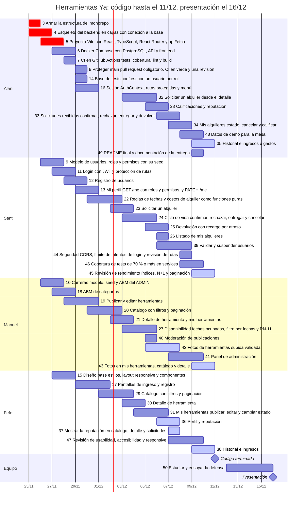

# Cronograma

Plan para terminar el código el **11/12**, estudiar y ensayar del **12 al 15/12** y presentar el **16/12**. Cada fila del Gantt es una persona; las barras que se superponen entre filas son trabajo en paralelo.

- **En rojo:** el esqueleto (#3, #4, #5). Es lo único que bloquea el inicio de otras tarjetas, y en GitHub está marcado como *blocked by*.
- **En otro color:** prioridad Media o Baja. Es lo primero que se recorta si hay atraso.
- **El resto de las dependencias no bloquea:** se arranca contra el contrato de `docs/requisitos.md` §6 y §7, y solo hace falta que la otra tarjeta esté en Hecho para entregar (regla 3 de [Cómo trabajamos](como-trabajamos.md)).

La planificación supone unas 3,5 h por día por persona, fines de semana incluidos, y unas 4,5 h para Alan. Los talles se cuentan como S = 2 h, M = 4 h y L = 7 h. Todos terminan el 10/12, así que queda un día de margen.

## Fuente de verdad

Las fechas viven en los campos **Inicio** y **Fin** del Project, que se ven en la vista «Cronograma (Gantt)». Este archivo es una foto del plan al 24/11. Si una tarjeta se atrasa:

1. Se corrige su Fin en el Project.
2. Se avisa en el grupo, porque puede correr las fechas de otras tarjetas.
